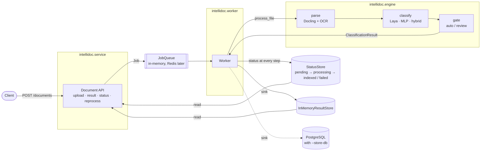

# intellidoc

Modular document analysis API. Documents go through one pipeline of separate stages, each behind
an interface so it can be swapped or extended on its own:

```
ingest ──► parse ──────────────────► classify ─────────────────────────► gate ──► auto / review
           Docling, OCR fallback     Laya (zero-shot), trained MLP,      confidence
           │                         or both (hybrid)                    threshold
           │ unreadable file         │ model failed
           └─────────────────────────┴──► error + failed_step
```

`auto` means the primary answer cleared its confidence threshold; `review` means a human should look
(low confidence, or a readable file with too little text, such as a blank scan). `error` means the
document could not be processed: the file is unreadable or the model crashed. It is recorded with
the step that failed, so it can be listed and reprocessed.

Today the pipeline classifies documents (type plus yes/no and score questions), stores results in
PostgreSQL with German/English full-text search, and learns from human reviews. Structured field
extraction, validation and embedding retrieval are the next stages (see [Roadmap](#roadmap)).

Classification uses [Laya](https://huggingface.co/convaiinnovations/laya), a non-generative
decision model that returns typed answers with confidence scores, and/or a classifier trained on
your own documents the way [paperless-ngx](https://docs.paperless-ngx.com/advanced_usage/#automatic-matching)
does it. You define the categories in `config.yaml`; no training is needed to get started.

## Packages



Edge labels `Job` and `ClassificationResult`, and the `ProcessingState` kept in the status store, are
the types in `intellidoc.contracts`: the only thing service and worker share.

The service accepts an upload, stores the original and puts a `Job` on the queue. The worker takes
the job, runs the engine, and records each step in the status store. When a document is processed,
the worker hands the result to its sinks: an in-memory result store that `GET /documents/{id}` reads,
and PostgreSQL when enabled. A document is `indexed` only after every sink has accepted it; if a
sink fails, the document is `failed` with that sink as the failed step.

| Package | Role | May import | Install |
|---|---|---|---|
| `intellidoc.contracts` | The types that cross process boundaries: `Job` (with `schema_version`), `ProcessingState`, `ClassificationResult`. Data only. | nothing | core (Pydantic) |
| `intellidoc.engine` | Processes one document. All stages, models and result storage live here. | `contracts` | `[worker]` |
| `intellidoc.worker` | Takes `Job`s from a `JobQueue`, runs the engine, records `pending → processing → indexed / failed` with the failed step in a `StatusStore`, hands results to sinks (`InMemoryResultStore`, `PostgresSink`). Keeps running if one iteration fails. | `engine`, `contracts` | `[worker]` |
| `intellidoc.service` | The Document API clients talk to: stores the original, enqueues a job, reports status and results. Never runs models; reaches the queue, status store and results through its own `ports`. | `contracts` | `[api]` |
| `intellidoc.devstack` | Wires everything in one process for local development: in-memory queue, status and result stores, a worker thread, and PostgreSQL with `--store-db`. | everything | `[all]` |

`tests/test_boundaries.py` fails if an import breaks this layering, and checks that importing the
service loads none of the engine's dependencies. The queue, status store and result store are
interfaces with in-memory implementations. In production, Redis/Celery and PostgreSQL tables
replace them, and service and worker run as separate processes. In-memory state is lost on restart,
and so is a job whose iteration failed; a real queue should acknowledge a job only after it is
processed.

Extras: `api` (FastAPI), `worker` (Docling, scikit-learn, PostgreSQL), `laya` (optional zero-shot
model, pulls in torch), `all` (all three), `dev` (tests). A Document API image needs only `.[api]`.

## Quick start

```bash
python -m venv .venv && source .venv/bin/activate
pip install torch --index-url https://download.pytorch.org/whl/cpu   # or the CUDA build
pip install -e ".[all,dev]"                                         # everything; see Packages for the extras
cp config.example.yaml config.yaml

# smoke test without downloading the model (keyword stand-in, not a real classifier)
python tools/make_samples.py samples
intellidoc --backend keyword classify samples -r

# the real thing (first run downloads ~1 GB of weights from Hugging Face)
intellidoc classify ~/Documents/scans -r -o results.csv
intellidoc sort ~/Documents/inbox ~/Documents/sorted -r    # copies into sorted/<label>/ and sorted/_review/
intellidoc serve --port 8080                               # engine API: upload -> result (synchronous)
intellidoc serve-stack --port 8080                         # Document API + in-process worker (asynchronous)
intellidoc serve-stack --store-db                          # ... and store results in PostgreSQL
intellidoc index ~/Documents/scans -r                      # classify + store in PostgreSQL
intellidoc search "Kündigung Mietvertrag"                  # full-text search over stored documents

# learn from your own documents (labelled/<label>/*.pdf); the default hybrid backend picks the model up
intellidoc train labelled/
intellidoc classify ~/Documents/inbox -r
```

With Docker:

```bash
cp config.example.yaml config.yaml
docker compose up --build
curl -F file=@rechnung.pdf http://localhost:8080/classify
```

## Configuration

`config.yaml` has one section per stage and is validated at startup (unknown keys and out-of-range
values are rejected with the key in the message):

| Key | Meaning |
|---|---|
| `parsing.max_pages` | How many pages are extracted, stored and searchable (empty = all) |
| `parsing.ocr` / `ocr_language` | OCR scanned PDFs with Docling (Tesseract if installed, else Docling's default engine) |
| `classification.backend` | `hybrid` (default), `ml`, `laya` or `keyword`; `--backend` and `INTELLIDOC_BACKEND` override it |
| `classification.primary` | The choice question that is "the" class (used for sorting and evaluation) |
| `classification.min_confidence` | Below this, results get status `review` (per-question override: `min_confidence` on the question) |
| `classification.max_pages` / `max_chars` | How much of each document the classifier reads |
| `classification.laya.checkpoint` | `multilingual` (default, 100+ languages, 1024 tokens), `english` (512 tokens), `typed-decisions`, or `auto` (Router decides per document) |
| `classification.laya.scan` | `first` scores the first token window only; `long` slides over all extracted text and aggregates |
| `classification.laya.max_len` / `head_max_len` | Optional token-budget overrides |
| `classification.ml.model_path` | Where `intellidoc train` writes the trained classifier |
| `classification.ml.combine` / `weight` | hybrid: `ml` (trained model decides the primary label) or `average` (`weight` × model + (1 − `weight`) × Laya) |
| `classification.ml.min_df` | Ignore words/bigrams found in fewer than this share of training documents |
| `classification.questions` | `choice` (labels → description), `noul` (yes/no probability), `score` (ordered levels) |
| `storage.*` | PostgreSQL connection, table, text search configurations, whether to store the text |

The description next to each label is what Laya compares the text against, so it matters most.
Keep descriptions short and distinctive, and include the words that actually appear in your documents
(e.g. both "invoice" and "Rechnung"). With more than 16 labels the classifier automatically switches to
Laya's `predict_tournament` (labels are judged in groups, then the finalists).

## Measuring accuracy: do this first

Laya's base checkpoints are weak zero-shot and over-confident, so measure before you trust it:

1. Put 10–30 real PDFs per label into `labelled/<label>/` (folder names = label keys in the config).
2. Run `intellidoc evaluate labelled/ --report-dir eval-report`.
3. Read `eval-report/report.md`:
   - **accuracy** and the **confusion matrix** show which labels get mixed up. Sharpen those descriptions, merge labels, or split the question.
   - **accuracy vs. coverage** shows what `classification.min_confidence` buys you: at 0.8, maybe 60% of PDFs are handled automatically at 95% accuracy.
   - **ECE** (expected calibration error) shows how far confidence is from reality.
4. `eval-report/predictions.jsonl` has every answer, including all class probabilities.

Iterate on the descriptions until the numbers stop improving. If they plateau too low, fine-tune.

## Trained classifier (paperless-ngx style)

paperless-ngx does not understand documents; it learns from the ones you have already filed.
Each document's text is lowercased, stripped of punctuation, and turned into word and word-pair
counts (scikit-learn `CountVectorizer`, 1–2 grams). A small neural network (`MLPClassifier`) is
trained on those counts and retrained when the filed documents change.
`classification/trained.py` does the same for the primary question. One small change: numbers are dropped, because invoice numbers,
amounts and dates differ in every document.

| | Laya (`--backend laya`) | Trained (`--backend ml`) | Hybrid (`--backend hybrid`) |
|---|---|---|---|
| Needs training data | no | yes, ideally 10+ per label | no; uses the model once it exists |
| Learns your senders/layouts | no | yes | yes |
| Yes/no and score questions | yes | no | yes (Laya) |
| Inference cost | transformer forward pass | milliseconds on CPU | about Laya's |
| Dependencies | torch, ~1 GB weights | scikit-learn | both |

**Training data** comes from labelled folders, from human reviews in PostgreSQL, or from both:

```bash
intellidoc train labelled/                      # labelled/<label>/*.pdf, folder names = label keys
intellidoc train --from-db                      # documents with an `intellidoc review` label
intellidoc train labelled/ --from-db --include-auto # also confident unreviewed results (can reinforce mistakes)
```

`train` prints how many examples each label has, which labels have none (the model can never
predict them), and a **cross-validated accuracy**: an honest estimate, because each document is
scored by a model that did not see it during training. Don't run `intellidoc evaluate` with
`--backend ml` on the training folder; the model has memorised it. Extracted text is cached in
`models/text-cache.jsonl`, so retraining doesn't re-run Docling. If the training data hasn't
changed, `train` does nothing (`--force` retrains anyway), so it is cheap to run from cron, the way
paperless-ngx retrains hourly. The model file is re-read when it changes, so a running server picks
up the new model without a restart.

**The workflow:**

1. Start with the default `hybrid` backend. Without a trained model it is plain Laya (zero-shot).
   Store results in PostgreSQL (`intellidoc index`).
2. Correct wrong labels with `intellidoc review <doc_id> <label>`.
3. `intellidoc train --from-db` (plus any labelled folders) as soon as each label has a few examples.
4. From then on the trained model sets the label (the model file is re-read, no restart needed) and
   Laya keeps answering the yes/no and score questions. With `classification.ml.combine: average` both vote, which helps while training data is thin.
   The primary answer keeps both opinions under `answers.<primary>.sources`.
5. Keep reviewing and retraining. Every correction improves the model.

The model file is a Python pickle: only load files you trained yourself, and retrain after
upgrading scikit-learn (you'll get a warning).

## HTTP API

There are two APIs. The **engine API** (`intellidoc serve`, also the Docker image's default) classifies
synchronously and is handy for testing and integrations. The **Document API** (`intellidoc serve-stack`)
is the start of the product API: uploads return at once and processing runs in the worker.

Document API (sketch: no authentication or repositories yet). Uploads are checked by content
(must start with `%PDF`) and size (`INTELLIDOC_MAX_UPLOAD_MB`, default 50):

| Method | Path | Body | Returns |
|---|---|---|---|
| GET | `/health` | | |
| POST | `/documents` | multipart `file` (PDF) | 202 + `document_id`, `sha256`, `status: pending` |
| GET | `/documents/{id}` | | name, processing state, and the classification result once indexed |
| GET | `/documents/{id}/status` | | `pending` / `processing` / `indexed` / `failed` (+ `failed_step`, `error`) |
| GET | `/documents/failed` | | failed documents |
| POST | `/documents/{id}/reprocess` | | re-enqueue a failed document (409 otherwise) |

```bash
intellidoc --backend keyword serve-stack --port 8080
curl -F file=@samples/invoice/invoice_1.pdf localhost:8080/documents     # -> {"document_id": "...", ...}
curl localhost:8080/documents/<document_id>/status
curl localhost:8080/documents/<document_id>        # state + result
```

Results are kept in memory; `serve-stack --store-db` (or `INTELLIDOC_STORE_DB=1`) also writes them to
PostgreSQL, keyed by `document_id`, so two uploads of the same file stay two rows.

Engine API:

| Method | Path | Body | Returns |
|---|---|---|---|
| GET | `/health` | | backend name |
| GET | `/labels` | | configured labels and questions |
| GET | `/model` | | trained classifier: labels, sample counts, CV accuracy (or `null`) |
| POST | `/classify` | multipart `file` (PDF) | result JSON |
| POST | `/classify-text` | `{"text": "..."}` | result JSON |

The result schema (`ClassificationResult`) is published at `/openapi.json` and `/docs`.

Result (shortened):

```json
{
  "file": "rechnung.pdf",
  "label": "invoice",
  "confidence": 0.91,
  "status": "auto",
  "flags": {"needs_payment": 0.87, "contains_personal_data": 0.12, "urgency": 1.4},
  "low_confidence": [],
  "answers": {"document_type": {"choice": "invoice", "probabilities": {"invoice": 0.91, "...": 0.0}, "confidence": 0.91}},
  "warnings": [], "ocr_used": false, "model": "multilingual", "elapsed_ms": 140
}
```

## PostgreSQL

Results are stored as one row per document in the `storage.table` table. The CLI keys rows by the
file's SHA-256, so re-classifying a file updates its row; the Document API keys them by its
`document_id` (every upload is a new document). A row holds file metadata, the extracted text, the primary
label and status as columns, every answer with its confidence in an `answers` jsonb column, and an
optional human review (`review_label`, `reviewed_by`, `reviewed_at`, `review_note`). Re-classifying
keeps the review. Adding questions or labels needs no migration.

```bash
docker compose -f docker-compose.yml -f docker-compose.db.yml up -d postgres   # local dev database
intellidoc db-schema                   # print the CREATE TABLE generated from the config
intellidoc db-setup                    # create it (index/db-load/the API also do this on first use)
intellidoc index ~/Documents/scans -r  # classify + store
intellidoc db-load results.jsonl       # store the output of `classify -o results.jsonl --with-text`
intellidoc review <doc_id> <label> --by me # record the correct label
intellidoc search "Rechnung Stadtwerke" -l invoice   # websearch syntax: "phrase", -exclude, or
```

The API takes `POST /classify?store_result=true`. The connection comes from `storage.url`, or
`DATABASE_URL` if it is set. Full-text search stems German and English words (`storage.text_search`).
Plain SQL works too:

```sql
-- low-confidence results still waiting for a human
SELECT doc_id, file_name, label, confidence FROM documents
WHERE status = 'review' AND review_label IS NULL ORDER BY confidence;

-- where the model and the reviewers disagree
SELECT label, review_label, count(*) FROM documents
WHERE review_label IS NOT NULL AND review_label IS DISTINCT FROM label GROUP BY 1, 2 ORDER BY 3 DESC;

-- documents that ask for payment
SELECT file_name FROM documents WHERE (answers -> 'needs_payment' ->> 'value')::boolean;
```

## Next steps

- **Calibration:** Laya ships `laya.fit_temperatures` / `fit_abstention_thresholds`. Feed them the probabilities from `predictions.jsonl` to get honest confidences.
- **More than one learned field:** paperless-ngx also learns correspondents, tags and storage paths. `classification/trained.py` trains one model for `classification.primary`; more choice questions would follow the same pattern with one model file each.
- **Fine-tuning:** the Laya repo has a [Kaggle notebook](https://github.com/NandhaKishorM/laya/blob/main/notebooks/laya_finetune_typed_decisions_2xT4_kaggle.ipynb) (free 2×T4). Your labelled folders are the dataset. Point `classification.laya.checkpoint` at the result by extending `LayaBackend` with `Router(models=...)`.
- **paperless-ngx:** add a workflow (trigger *Document Added*, action *Webhook*) that calls a small adapter. The adapter fetches `/api/documents/{id}/` (content), calls `/classify-text`, and `PATCH`es `document_type` when `status == "auto"`.

## Layout

```
src/intellidoc/
  contracts/                    types that cross process boundaries (Pydantic only)
    jobs.py                     Job (schema_version), ProcessingState (pending/processing/indexed/failed)
    results.py                  ClassificationResult (response schema), statuses, failed_step
  engine/                       one document in, one typed and gated result out
    config.py                   Settings: one Pydantic section per stage, loaded from YAML
    ingestion.py                file discovery, PDF check by content, SHA-256 identity
    parsing/                    Parser interface, ParsedDocument; docling.py: Docling + OCR fallback
    classification/             Classifier interface, make_classifier
      laya.py · trained.py · hybrid.py · keyword.py
      gating.py                 confidence gate: label, status, flags
      evaluation.py             accuracy, per-class metrics, confusion matrix, ECE, threshold sweep
    storage/postgres.py         schema, result → row, upserts, PostgresSink, reviews, full-text search
    api/app.py                  engine API (FastAPI, synchronous)
    pipeline.py                 DocumentPipeline: parse → classify → gate
  worker/
    queue.py                    JobQueue interface, InMemoryQueue
    status.py                   StatusStore interface, InMemoryStatusStore
    results.py                  InMemoryResultStore: a sink the Document API reads results from
    runner.py                   Worker: job → engine → sinks, status at every transition, survives failures
  service/
    app.py                      Document API (FastAPI): upload, result, status, failed list, reprocess
    ports.py                    what the service needs: JobSubmitter, StatusStore, ResultReader
  devstack.py                   composition root for local development
  cli.py                        classify | sort | evaluate | train | serve | serve-stack | index | search | db-* | review
tools/make_samples.py           synthetic sample PDFs for smoke tests
tests/                          pytest, one file per module (no torch or Laya weights needed;
                                set INTELLIDOC_TEST_DATABASE_URL for the PostgreSQL tests)
docs/                           requirements, backlog, permission matrix
```

A new engine stage gets its own package with an interface (a `Protocol`) and is wired in
`engine/pipeline.py`; the other stages, the worker and the service don't change.

## Roadmap

1. **MVP ingestion/extraction:** schema-first extraction (Pydantic models per document type) after the gate, plus validation
2. **Hybrid ML/LLM:** rules and templates first, a structured-output LLM for what they can't handle; quality prediction
3. **Embeddings / pgvector:** retrieval of verified examples, semantic search
4. **Laya benchmarking** against the trained classifier on labelled baselines
5. **Production hardening:** queue (Redis/Celery), object storage (S3/MinIO), auth, tracing
6. **Optimization:** cost, latency and selective model use
