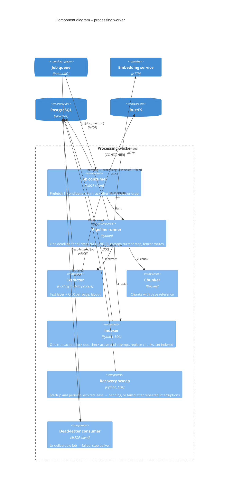
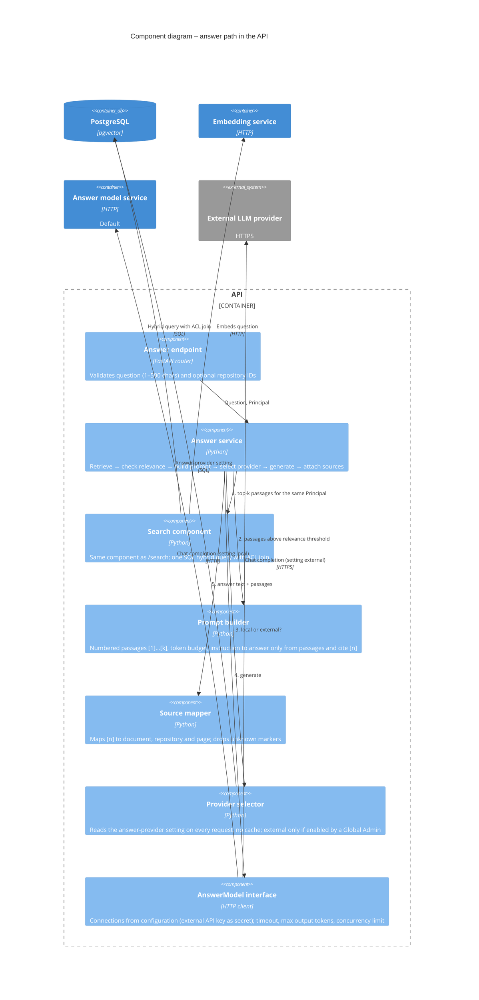

# Component diagrams

These C4 diagrams show the processing worker and the answer path in the API. See the [architecture overview](../docs/architecture.md#4-level-3--components).

## Processing worker

## Answer path in the API

Answers are orchestrated in the API, not in the answer model: retrieval goes through the same search component as `/search`, so the permission filter is applied in exactly one place (REQ-ANS-3). The answer model – local or external – only ever receives the question and passages the Principal may currently find. Which of the two is used is decided per request by the system-wide setting that only a Global Admin can change (REQ-ANS-5).

