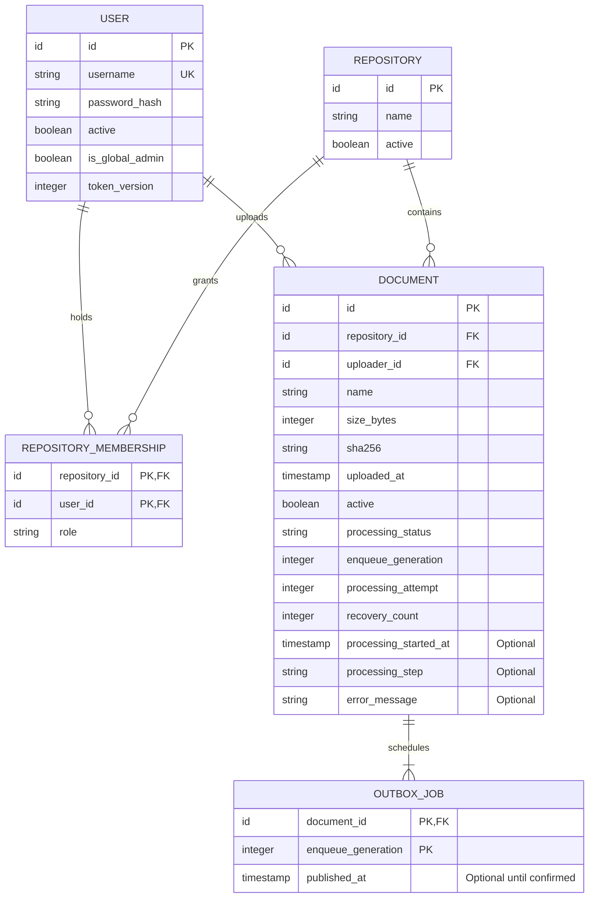

# Core data model

This draft ERD covers users, repository access, document metadata, and processing jobs.
The search schema is described in [ADR-0009](../docs/adr/0009-use-postgresql-with-pgvector-as-search-index.md).

## Constraints

- Usernames are unique under the chosen login comparison rule. Changes that could remove the last active Global Admin must enforce that invariant even when requests run concurrently.
- Active repository names are unique case-insensitively. A membership gives one user one role in a repository: Repo Admin, Contributor, or Reader. Global Admin access comes from the user record.
- Document activity and processing status are independent. Processing statuses are `pending`, `processing`, `indexed`, and `failed`. The original is stored under a key derived from the document ID. Repeated uploads can share a checksum and each receives its own ID.
- After the original is stored, the upload commits the document and its first outbox job together. When a transaction's commit outcome is unknown, retain the original until the database state can be verified.
- The enqueue generation is a proposed refinement to [ADR-0007](../docs/adr/0007-deliver-processing-jobs-via-rabbitmq-with-transactional-outbox.md). Each retry or recovery advances it and inserts a new outbox row in the same transaction. Claim and dead-letter updates check the message's generation against the document's current generation. The separate `processing_attempt` guards writes from workers after a claim.

See the [requirements](../docs/requirements.md), [authentication ADR](../docs/adr/0004-authenticate-with-signed-jwt-and-per-request-user-check.md), and [upload ADR](../docs/adr/0012-validate-uploads-before-storing-original-and-metadata.md).
