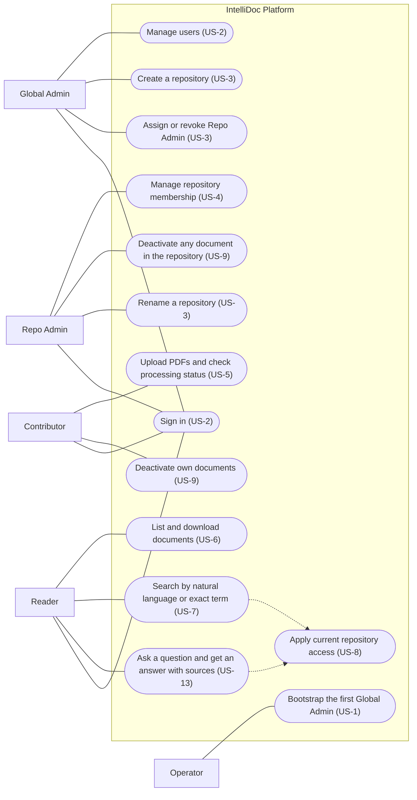

# MVP use cases

The diagram shows the Must user stories from the [requirements](../docs/requirements.md#31-overview) and the [MVP scope](../docs/mvp.md#3-included-must).
Repository permissions are cumulative from Reader to Contributor to Repo Admin.
A Global Admin has Repo Admin permissions in every active repository.

