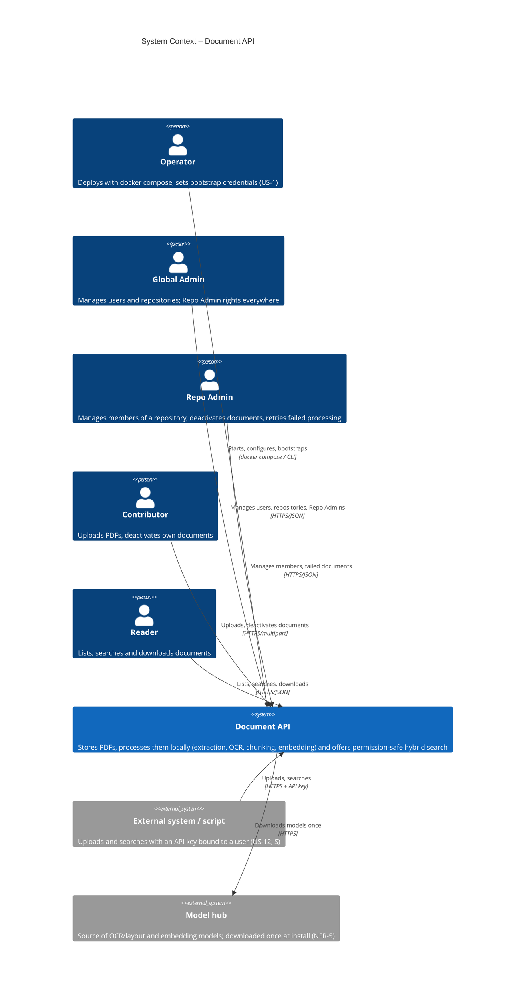
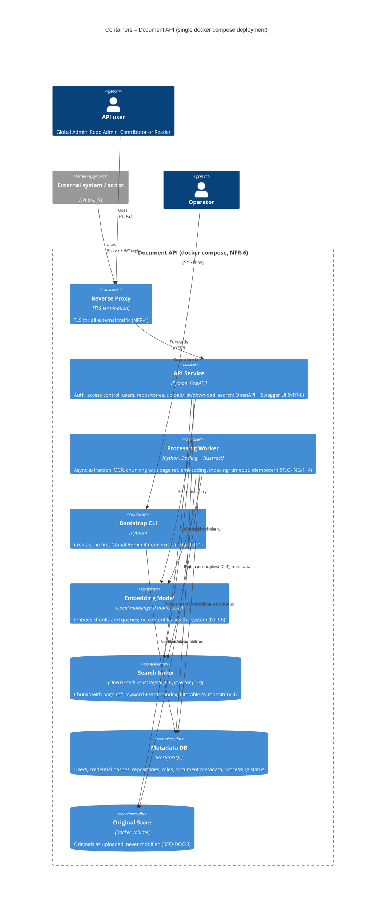
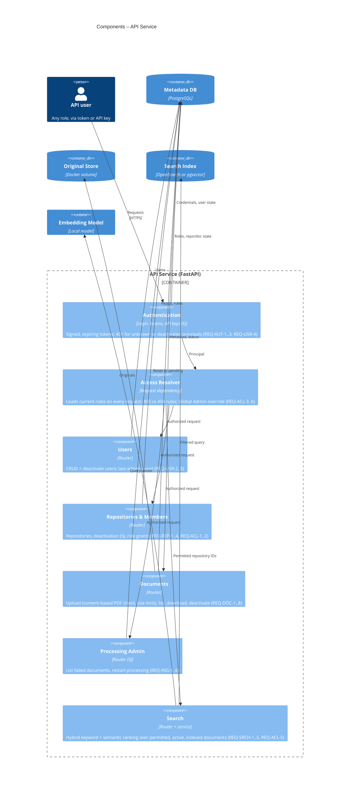
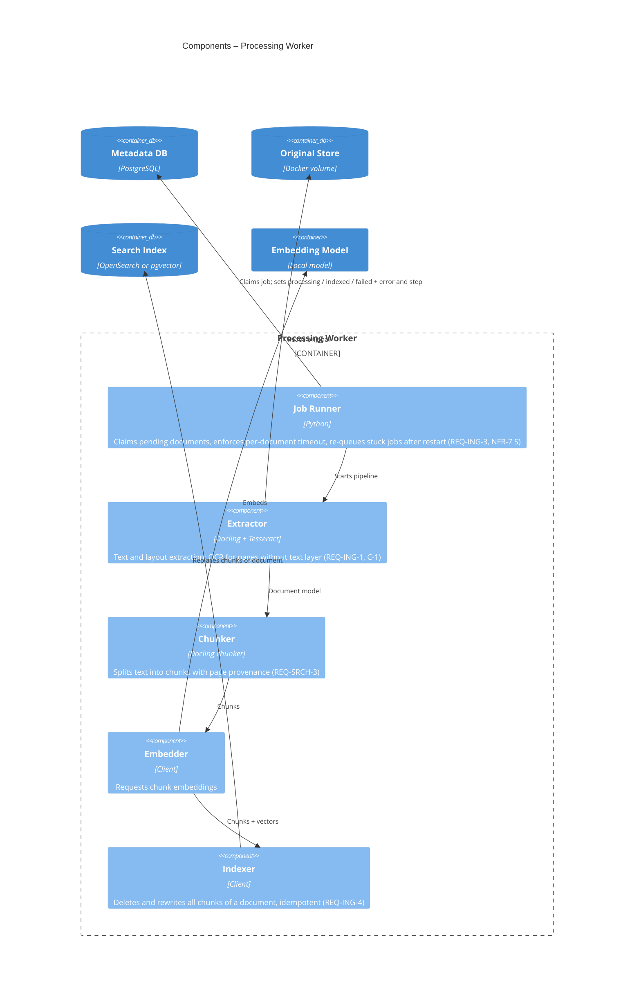

# Architecture – C4 Diagrams (Document API)

C4 views derived from `docs/requirements.md` and `docs/mvp.md`. Requirement IDs in labels point to the requirement a part serves.

Open decisions are shown as alternatives, not settled: the search engine (C-3: OpenSearch **or** PostgreSQL + pgvector) and the concrete embedding model (C-2). Parts that are Should only are marked *(S)*.

## 1. System Context

## 2. Containers

## 3. Components – API Service

## 4. Components – Processing Worker

