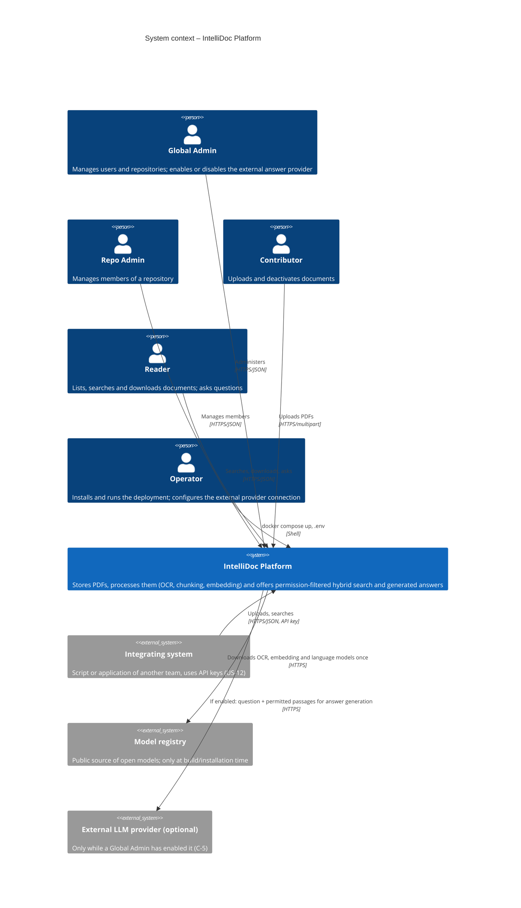
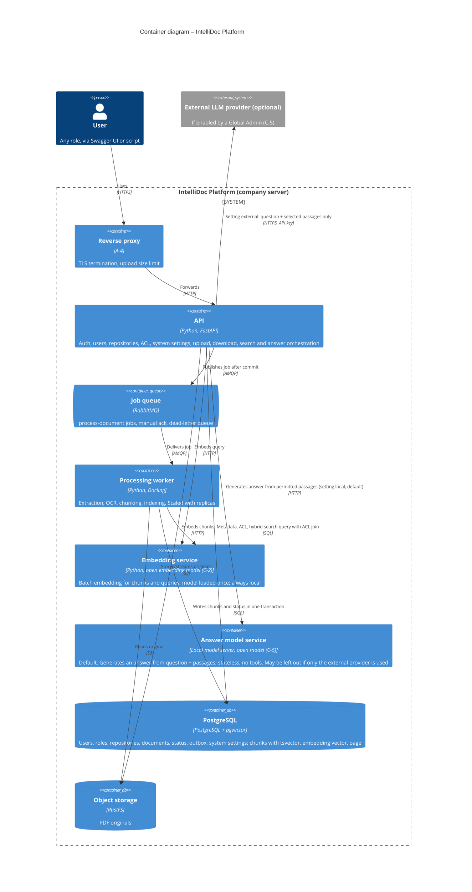
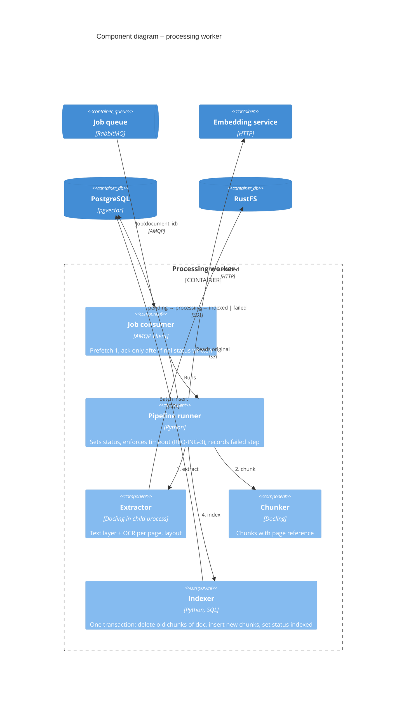
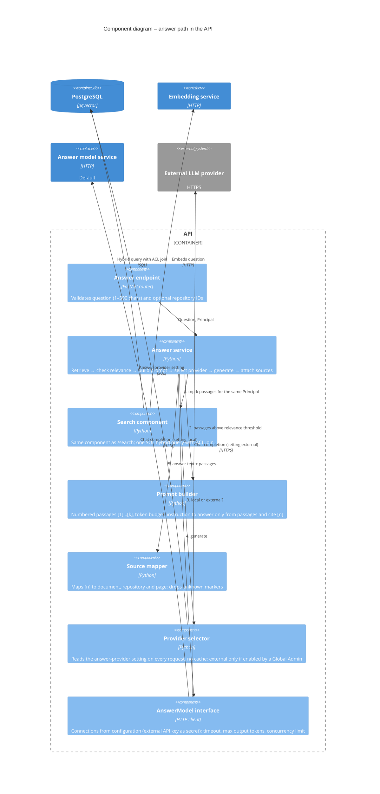

# Architecture – IntelliDoc Platform

Scope of this document: technical constraints and the chosen architecture, described with the [C4 model](https://c4model.com/) (levels 1–3), how it meets the key requirements, its trade-offs, and the spike that confirms it. The alternatives that were considered and the reasons for this choice are in [ADR-0001](adr/0001-use-api-worker-pool-and-postgresql-search.md). Requirements and IDs are in [`requirements.md`](requirements.md), the MVP boundary in [`mvp.md`](mvp.md).

> **Status:** Draft for discussion. The architecture is proposed in [ADR-0001](adr/0001-use-api-worker-pool-and-postgresql-search.md) and becomes final after the spike described in section 7. Memory use and latency are not yet measured; the spike measures them on the reference environment.

## 1. Technical constraints and decisions

These are deliberate decisions, not requirements; they may change without changing [`requirements.md`](requirements.md).
Constraints and assumptions are moved into Architectural Decision Records in [`adr/`](adr/README.md) as they are decided.
Once an ADR exists, it is authoritative: the entry here keeps its ID and a one-line summary, and the details and reasons are only in the ADR.
Products and providers are named only where an ADR decides them.

### 1.1 Decided in an ADR

| ID | Summary | ADR |
|---|---|---|
| C-1 | Docling for text extraction, layout analysis, OCR and chunking. | [ADR-0008](adr/0008-process-documents-with-docling-in-isolated-child-process.md) |
| C-3 | The local PostgreSQL with pgvector and full-text search is the search index; OpenSearch is the fallback behind the `SearchIndex` interface. | [ADR-0009](adr/0009-use-postgresql-with-pgvector-as-search-index.md) |
| C-4 | Search is filtered by the Principal's repository IDs, read from PostgreSQL on every request. | [ADR-0005](adr/0005-filter-search-by-repository-at-query-time.md) |
| C-5 | Answers are generated by a local language model by default; a Global Admin can enable an external provider for the whole system, for answers only. | [ADR-0010](adr/0010-generate-answers-locally-with-opt-in-external-provider.md) |
| A-1 | Application code in Python with FastAPI, structured as ports and adapters. | [ADR-0002](adr/0002-use-python-and-fastapi-with-ports-and-adapters.md) |
| A-2 | Signed JWT access tokens with a per-request user check in PostgreSQL. | [ADR-0004](adr/0004-authenticate-with-signed-jwt-and-per-request-user-check.md) |
| A-5 | Docling runs in a child process that is killed on timeout. | [ADR-0008](adr/0008-process-documents-with-docling-in-isolated-child-process.md) |
| – | Processing jobs are delivered via RabbitMQ with a transactional outbox. | [ADR-0007](adr/0007-deliver-processing-jobs-via-rabbitmq-with-transactional-outbox.md) |
| – | Originals are stored in RustFS via the S3 API. | [ADR-0011](adr/0011-store-originals-in-rustfs.md) |

### 1.2 Open constraints

Decided by the spike in section 7; each gets its own ADR.

- **C-2 Local embedding model.** A multilingual open embedding model runs inside the deployment (REQ-SRCH-5). The concrete model is chosen by running NFR-3's evaluation set.

### 1.3 Other assumptions

| ID | Assumption | Reason |
|---|---|---|
| A-3 | PostgreSQL is the source of truth for users, roles, repositories, documents and processing status. | Transactional consistency for access control (REQ-ACL-6). |
| A-4 | A reverse proxy terminates TLS; the product is chosen with the deployment setup. | NFR-4. |
| A-6 | Models are downloaded into the image or a volume at build time; at runtime no outbound traffic is needed, except to the external answer provider while a Global Admin has enabled it (C-5). | Local operation (README). |
| A-7 | The deployment stays portable to an orchestrator: services keep no local state apart from the data stores, and all configuration comes from the environment. Not tested in this semester. | Operation beyond a single host later. |

## 2. Level 1 – System context

The IntelliDoc Platform is one system used by people through Swagger UI or scripts and by other systems through the API.

## 3. Level 2 – Containers

**Idea:** separate the load profiles, but keep all document data on the company server in one store. The **API** handles requests, a **message broker** decouples uploads from a pool of **processing workers**, a shared **embedding service** serves both workers and search, and the local **PostgreSQL** with **pgvector** holds metadata, permissions *and* the hybrid search index (full-text + vectors). Originals go to **RustFS** (S3-compatible) on the same server. Answers are generated by an **answer model** from the passages the API retrieved (retrieval-augmented generation). The answer model is reached through one HTTP interface: by default a local service, or – if a Global Admin has enabled it for the whole system, see C-5 – an external provider, which then receives only the question and the selected passages. The API reads this setting on every answer request, so disabling it takes effect immediately. Documents, chunks, vectors and metadata never leave the server; embeddings are always computed locally.

## 4. Level 3 – Components

### 4.1 Processing worker

### 4.2 Answer path in the API

Answers are orchestrated in the API, not in the answer model: retrieval goes through the same search component as `/search`, so the permission filter is applied in exactly one place (REQ-ANS-3). The answer model – local or external – only ever receives the question and passages the Principal may currently find. Which of the two is used is decided per request by the system-wide setting that only a Global Admin can change (REQ-ANS-5).

## 5. How the key requirements are met

Each row names the mechanism; the rules and their reasons are in the linked ADR.

| Concern | Mechanism | Details |
|---|---|---|
| Permission-safe search (REQ-ACL-5) | One SQL hybrid query filters on the Principal's repository IDs, read on every request, inside every sub-query, so hits and counts never include other documents. | [ADR-0005](adr/0005-filter-search-by-repository-at-query-time.md) |
| Immediate effect (REQ-ACL-6) | Role, repository and document changes are ordinary commits in the same database as the index; the next search sees them. | [ADR-0009](adr/0009-use-postgresql-with-pgvector-as-search-index.md) |
| Status filter (AC-7.5) | Chunks are replaced and status `indexed` is set in one transaction; other statuses are excluded by the query. | [ADR-0009](adr/0009-use-postgresql-with-pgvector-as-search-index.md) |
| Hybrid search (REQ-SRCH-2, -4) | Full-text, exact-term and vector matches are fused in one ranked list; exact-term ranking is the **main search risk** and is proven in the spike. | [ADR-0009](adr/0009-use-postgresql-with-pgvector-as-search-index.md) |
| Async processing (REQ-ING-1..4, NFR-7) | Transactional outbox and broker redelivery; a sweep resets documents whose processing lease expired. | [ADR-0007](adr/0007-deliver-processing-jobs-via-rabbitmq-with-transactional-outbox.md) |
| Timeout and failed step (REQ-ING-3) | Extraction runs in a child process that is killed on timeout; the failed step is recorded. | [ADR-0008](adr/0008-process-documents-with-docling-in-isolated-child-process.md) |
| Permission-safe answers (REQ-ANS-1, -3) | The answer service retrieves passages only through the search component, with the requesting Principal. | [ADR-0010](adr/0010-generate-answers-locally-with-opt-in-external-provider.md) |
| Sources, no answer without evidence, answer time (REQ-ANS-2, -4, NFR-9) | Numbered passages are mapped back to sources; below a relevance threshold the model is not called; prompt size, output, time and concurrency are bounded. | [ADR-0010](adr/0010-generate-answers-locally-with-opt-in-external-provider.md) |
| Data stays on the company server (REQ-ANS-5) | Everything runs locally by default. An external provider for answers is used only while a Global Admin has enabled it for the whole system, receives only the question and selected passages, and the setting is read on every request, so disabling takes effect immediately. | [ADR-0010](adr/0010-generate-answers-locally-with-opt-in-external-provider.md) |
| Untrusted document text | The answer model has no tools and sees only passages the Principal may read, so injected text can at worst distort the answer. | [ADR-0010](adr/0010-generate-answers-locally-with-opt-in-external-provider.md) |
| Scaling and fault isolation | Workers, embedding and answer generation are separate services; if one fails, search, upload and download keep working. | [ADR-0001](adr/0001-use-api-worker-pool-and-postgresql-search.md) |

## 6. Trade-offs

- **+** Matches the README goal: upload, processing, embedding and answer generation are separate, independently scalable services.
- **+** All document data lives in one local store: ACL, status and deactivation are transactionally correct by construction, one backup covers metadata and index, and nothing can drift.
- **+** Answers reuse the search component, so they inherit the permission filter instead of re-implementing it; the answer model can be resized, replaced or switched to an external provider (C-5) without touching the API.
- **+** With an external provider for answers, the server needs neither the local answer model's memory nor its CPU time, which removes the largest risk for NFR-9 – at the price of sending passages to a third party, which a Global Admin must consciously enable.
- **−** Lexical ranking in PostgreSQL is weaker than BM25 (no BM25 natively, limited analyzers for German compound words); exact-term ranking (REQ-SRCH-4) needs the extra `simple` column and trigram index and must be proven by the evaluation set (NFR-3).
- **−** PostgreSQL is a single point of failure for metadata and search, and search load competes with ingestion writes on the same database. Mitigation if needed: batch inserts outside peak search, later a read replica for search.
- **−** 8 containers (7 if the operator leaves out the local answer model and relies on the external provider). Whether they fit the 16 GB reference host is open (Q-2) and measured in the spike. Fallbacks: a smaller answer model, an external provider (enabled by a Global Admin), or the PostgreSQL job table instead of RabbitMQ ([ADR-0007](adr/0007-deliver-processing-jobs-via-rabbitmq-with-transactional-outbox.md)).
- **−** With a local answer model, CPU-only generation competes with OCR and embedding for cores; answer time (NFR-9) must be measured in the spike.

## 7. Spike and next steps

The parts most likely to change are behind interfaces:

- The search component accesses the index only through a `SearchIndex` interface. If the evaluation set shows that PostgreSQL's lexical ranking is insufficient even with a BM25 extension, an OpenSearch implementation can replace it without touching the API – at the cost of a second store and the synchronous visibility update outlined in [ADR-0009](adr/0009-use-postgresql-with-pgvector-as-search-index.md).
- The worker pipeline is written as separate steps (extract → chunk → embed → index) with the failed step recorded (REQ-ING-3), so stages can later be split into separate services if OCR becomes the bottleneck.

**Spike before the decision is final (phase 2, see `mvp.md` §7):**

1. Start the full stack including the answer model service on the reference environment and measure memory with two workers under load.
2. Index a sample of the test corpus into PostgreSQL + pgvector and run the NFR-3 evaluation set (confirms C-3), with special attention to the exact-term queries (REQ-SRCH-4); if the target is missed, follow the fallback order of [ADR-0009](adr/0009-use-postgresql-with-pgvector-as-search-index.md). Run the same set against two or three candidate local embedding models (decides C-2).
3. Run the answer questions of the evaluation set against two or three candidate local language models and quantisations, measuring source correctness (AC-13.1) and answer time (NFR-9) while a worker is processing (decides the default model of C-5). Run the same questions once against an external provider through the same interface as a quality and latency baseline ([ADR-0010](adr/0010-generate-answers-locally-with-opt-in-external-provider.md)); this uses only the test corpus, never real documents.
4. Write the permission tests of AC-8.1–8.3 and AC-13.3 first and run them against the PostgreSQL search (AC-8.4).

The outcome confirms or revises [ADR-0009](adr/0009-use-postgresql-with-pgvector-as-search-index.md) (C-3) and [ADR-0010](adr/0010-generate-answers-locally-with-opt-in-external-provider.md) (C-5), is recorded in a new ADR for C-2, and ADR-0001 is set to `accepted` or replaced. Measured memory use and latency are added to this document.
