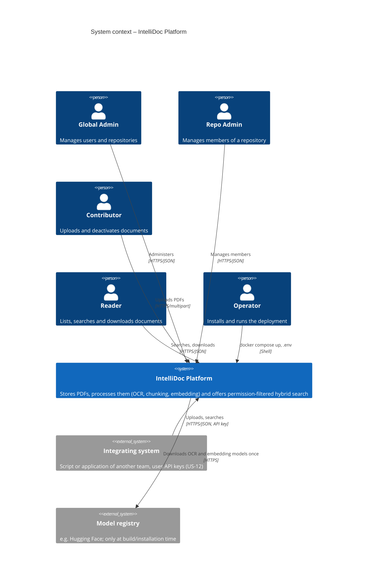
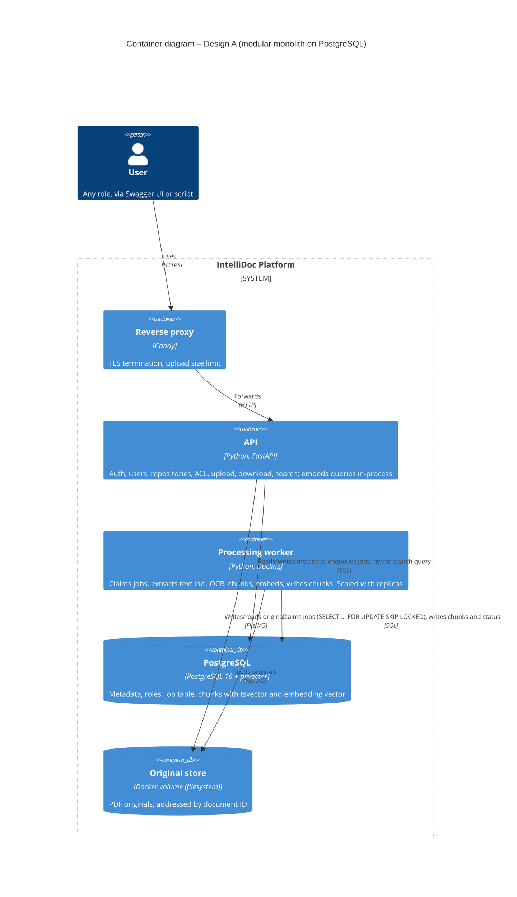
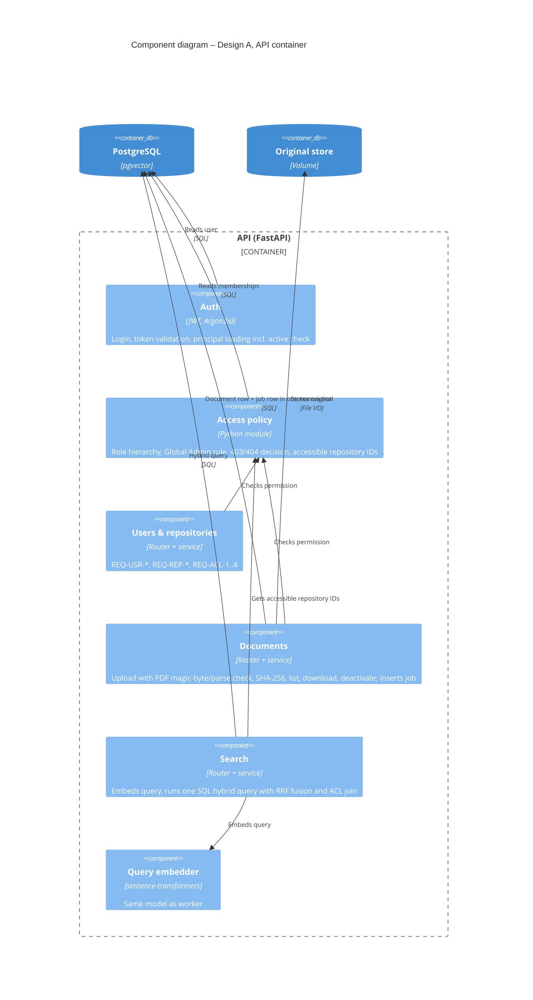
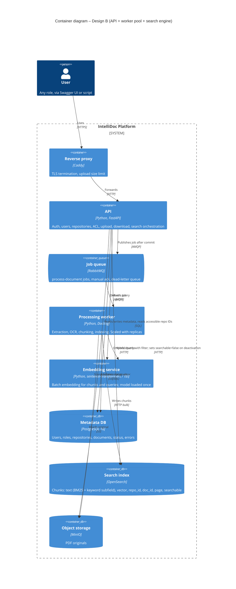
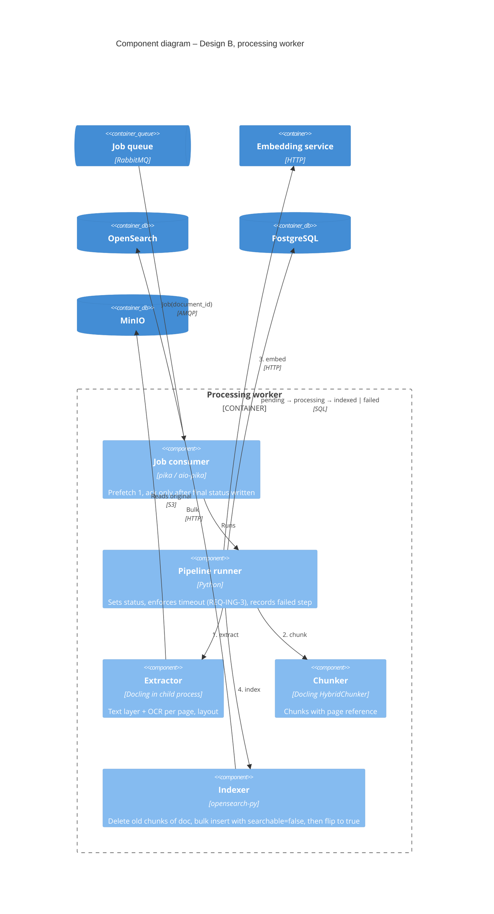
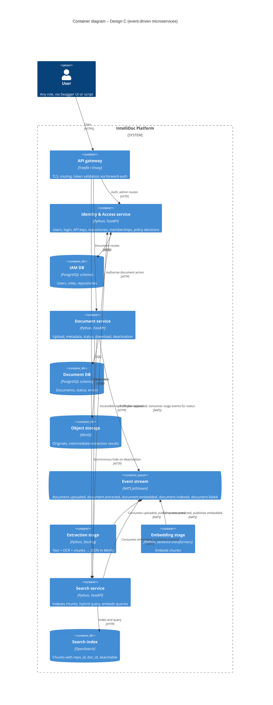
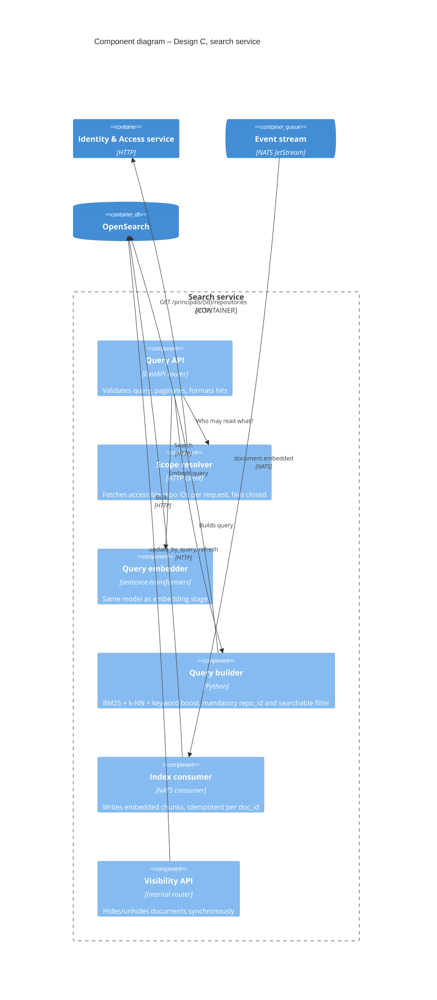

# Architecture – IntelliDoc Platform

Scope of this document: technical constraints, three candidate architectures described with the [C4 model](https://c4model.com/) (levels 1–3), their comparison against the requirements, and a recommendation. Requirements and IDs are in [`requirements.md`](requirements.md), the MVP boundary in [`mvp.md`](mvp.md).

> **Status:** Draft for discussion. The designs are alternatives; Design B is proposed in [ADR-0001](adr/0001-use-api-worker-pool-and-dedicated-search-engine.md) and becomes final after the spike described in section 7. Memory and latency figures are estimates to be verified on the reference environment.

## 1. Technical constraints and decisions

These are deliberate decisions, not requirements; they may change without changing [`requirements.md`](requirements.md).
Constraints and assumptions are moved into Architectural Decision Records in [`adr/`](adr/README.md) as they are decided.
Once an ADR exists, it is authoritative: the entry here keeps its ID and a one-line summary, and the details and reasons are only in the ADR.

### 1.1 Decided in an ADR

| ID | Summary | ADR |
|---|---|---|
| C-1 | Docling for text extraction, layout analysis, OCR and chunking. | [ADR-0008](adr/0008-process-documents-with-docling-in-isolated-child-process.md) |
| C-4 | Search is filtered by the Principal's repository IDs, read from PostgreSQL on every request; document visibility in the index is updated synchronously. | [ADR-0005](adr/0005-filter-search-by-repository-at-query-time.md), [ADR-0006](adr/0006-keep-postgresql-authoritative-and-update-index-visibility-synchronously.md) |
| A-1 | Application code in Python with FastAPI. | [ADR-0002](adr/0002-use-python-and-fastapi.md) |
| A-2 | Signed JWT access tokens with a per-request user check in PostgreSQL. | [ADR-0004](adr/0004-authenticate-with-signed-jwt-and-per-request-user-check.md) |
| A-5 | Docling runs in a child process that is killed on timeout. | [ADR-0008](adr/0008-process-documents-with-docling-in-isolated-child-process.md) |

### 1.2 Open constraints

Decided by the spike in section 7; each gets its own ADR.

- **C-2 Local embedding model.** A multilingual open embedding model runs inside the deployment (NFR-5, REQ-SRCH-5). The concrete model is chosen by running NFR-3's evaluation set.
- **C-3 Search engine.** One engine supporting keyword and vector search with a filter on repository ID in the same query (candidates: OpenSearch, PostgreSQL + pgvector).

### 1.3 Other assumptions common to all designs

| ID | Assumption | Reason |
|---|---|---|
| A-3 | PostgreSQL is the source of truth for users, roles, repositories, documents and processing status. | Transactional consistency for access control (REQ-ACL-6). |
| A-4 | A reverse proxy (e.g. Caddy or Traefik) terminates TLS. | NFR-4. |
| A-6 | Models are downloaded into the image or a volume at build time; at runtime no outbound traffic is needed. | NFR-5. |

## 2. Level 1 – System context (identical for all designs)

The context does not depend on the design: the IntelliDoc Platform is one system used by people through Swagger UI or scripts and by other systems through the API.

## 3. Design A – Modular monolith on PostgreSQL

**Idea:** one codebase, deployed as two container types: an **API** and a horizontally scalable **worker**. PostgreSQL does everything stateful: metadata, job queue, full-text index (`tsvector`) and vector index (`pgvector`). Originals lie on a shared volume.

### 3.1 Level 2 – Containers

### 3.2 Level 3 – Components of the API

### 3.3 How the key requirements are met

| Concern | Mechanism |
|---|---|
| Permission-safe search (REQ-ACL-5, REQ-ACL-6) | A single SQL statement joins `chunks → documents → repositories → memberships` and filters `document.active AND document.status = 'indexed' AND repository.active AND (membership.user_id = :me OR :is_global_admin)`. Access changes are visible to the next transaction; hit counts are computed in the same query. No index synchronisation exists, so nothing can drift. |
| Hybrid search (REQ-SRCH-2) | Two CTEs – `ts_rank` on `tsvector` and cosine distance on `pgvector` (HNSW) – fused with Reciprocal Rank Fusion in SQL. |
| Exact terms (REQ-SRCH-4) | The default text parser splits "2024-117"; an additional `simple`-configuration column plus a `pg_trgm` index on identifier-like tokens is needed. **Main risk of this design.** |
| Async processing (REQ-ING-1..4) | Upload inserts the document row and a job row in one transaction. Workers claim jobs with `SKIP LOCKED` and a lease (`locked_until`); an expired lease returns the job to `pending` (NFR-7). Re-processing deletes and inserts the document's chunks in one transaction (idempotent). |
| Scaling | More worker replicas (`docker compose up --scale worker=3`). The API scales separately but loads the embedding model per replica. |

### 3.4 Assessment

- **+** Fewest moving parts (4 containers); one backup covers metadata and index; ACL is transactionally correct by construction.
- **+** Lowest memory footprint (estimate ≈ 7–9 GB with 2 workers).
- **−** PostgreSQL is a single point of failure for everything, and search load competes with ingestion writes on the same database.
- **−** Lexical ranking in PostgreSQL is weaker than BM25 (no BM25 natively, limited analyzers for German compound words).
- **−** Only partly meets the "distributed system" goal from the README: processing is distributed, search is not.

## 4. Design B – API with worker pool and dedicated search engine

**Idea:** separate the three load profiles. The **API** handles requests, a **message broker** decouples uploads from a pool of **processing workers**, a shared **embedding service** serves both workers and search, and **OpenSearch** holds the hybrid index. PostgreSQL remains the source of truth for metadata and permissions; originals go to **MinIO** (S3-compatible).

### 4.1 Level 2 – Containers

### 4.2 Level 3 – Components of the processing worker

### 4.3 How the key requirements are met

| Concern | Mechanism |
|---|---|
| Permission-safe search (REQ-ACL-5) | The API reads the Principal's active repository IDs from PostgreSQL on every request (C-4) and sends them as a mandatory `terms` filter on `repo_id`, together with `searchable = true`, inside both the BM25 and the k-NN sub-query (pre-filtering, so hit counts are correct). The filter is added in one place in the search component, never by callers. |
| Immediate effect (REQ-ACL-6) | Role and repository changes: covered by reading repo IDs per request. Document deactivation: the API sets `searchable = false` for the document's chunks with `refresh=wait_for` **before** answering 200. If the index write fails, the DB change is rolled back and the API answers 503. |
| Status filter (AC-7.5) | Chunks are written with `searchable = false` and flipped to `true` only together with the DB status `indexed`. |
| Hybrid search (REQ-SRCH-2, -4) | OpenSearch hybrid query (BM25 + k-NN) with a normalisation/RRF search pipeline. A `keyword`/whitespace-analysed subfield matches identifiers such as "2024-117" exactly and gets a boost. |
| Async processing (REQ-ING-1..4, NFR-7) | Transactional outbox ([ADR-0007](adr/0007-deliver-processing-jobs-via-rabbitmq-with-transactional-outbox.md)): the API writes document + outbox row in one transaction; a relay publishes to RabbitMQ. Workers ack only after the final status is written, so a killed worker's job is redelivered. A sweep at worker startup and periodically resets documents in `processing` whose lease (start time + processing timeout) has expired to `pending`. Indexing deletes the document's chunks first (idempotent). |
| Scaling and fault isolation | Workers scale independently; a crashing or overloaded worker does not affect search or upload. The embedding service batches requests and holds the model only once. |

### 4.4 Assessment

- **+** Matches the README goal: upload, processing and search are separate, independently scalable services.
- **+** Strong lexical search (BM25, analyzers for German/English, exact keyword subfield) – lowest risk for REQ-SRCH-4 and NFR-3.
- **+** Search load does not hit the metadata database except for the small ACL lookup.
- **−** Two stores (PostgreSQL, OpenSearch) must be kept consistent for document state; requires the synchronous write on deactivation and a reconciliation job.
- **−** 8 containers; OpenSearch needs ≈ 2–4 GB heap. Estimated total ≈ 11–13 GB with 2 workers – fits the 16 GB reference host, but not with much headroom (open question Q-2).

## 5. Design C – Event-driven microservices

**Idea:** split by business capability. Each service owns its data. The processing pipeline is a chain of independent stages connected by a durable event stream; each stage scales separately (OCR is the bottleneck, embedding the second one).

### 5.1 Level 2 – Containers

### 5.2 Level 3 – Components of the search service

### 5.3 How the key requirements are met

| Concern | Mechanism |
|---|---|
| Permission-safe search (REQ-ACL-5, -6) | The search service asks the IAM service for the Principal's repository IDs on every request (no cache, fail closed if IAM is unavailable) and applies them as an index filter. Document deactivation calls the search service's visibility API synchronously, as in Design B. |
| Processing status (REQ-ING-2, -3) | Each stage publishes events; the document service derives the status. The timeout is enforced per stage and by a watchdog in the document service for documents without progress. |
| Robustness (NFR-7) | JetStream redelivers unacknowledged messages; each stage is idempotent per `document_id`. |
| Scaling | Extraction (OCR) and embedding stages scale independently; search and IAM scale separately. |

### 5.4 Assessment

- **+** Strongest fault isolation and the most fine-grained scaling; clean boundaries if further formats (US-15) or an answer service (US-13) are added later.
- **+** Showcases distributed-systems concepts (events, idempotent consumers, service-owned data) explicitly.
- **−** Every search and every document request now depends on a synchronous call to IAM: one more network hop for NFR-1 and one more failure point.
- **−** Status is derived from events across services – harder to make REQ-ING-2 transitions and AC-5.4 strictly correct; distributed debugging and tracing needed.
- **−** ≈ 11 containers; highest memory (estimate ≈ 13–15 GB) and by far the highest implementation and test effort for one semester. OpenSearch, PostgreSQL and two model copies (embedding stage, search service) compete for 16 GB.

## 6. Comparison

Ratings: ++ very good, + good, o acceptable, − weak, −− critical.

| Criterion | Requirement | A – Monolith on PostgreSQL | B – Worker pool + OpenSearch | C – Microservices |
|---|---|---|---|---|
| Correctness of permission filtering | REQ-ACL-5, -6 | ++ one transactional query | + DB lookup + synchronous index write | o synchronous IAM call + index write across services |
| Exact-term ranking | REQ-SRCH-4 | − needs custom tokenisation, to be proven | ++ keyword subfield + BM25 | ++ same as B |
| Search quality (lexical part, DE/EN) | NFR-3, REQ-SRCH-5 | o | ++ | ++ |
| Search latency | NFR-1 | + (risk: contention with ingestion) | ++ | + (extra hop) |
| Processing throughput / scaling | NFR-2 | + workers scale | ++ workers + shared embedding service | ++ per stage |
| Fault isolation (README goal) | – | − PostgreSQL is shared by all | + | ++ |
| Worker interruption | NFR-7 | + lease in job table | + broker redelivery + sweep | + stream redelivery |
| Single `docker compose up`, memory on 16 GB | NFR-6 | ++ 4 containers, ≈ 7–9 GB | + 8 containers, ≈ 11–13 GB | − ≈ 11 containers, ≈ 13–15 GB |
| Operations (backup, consistency) | NFR-6 | ++ one store | o two stores + reconciliation | − several stores, event replay |
| Implementation effort for one semester | mvp.md §7 | ++ | + | −− |
| Extensibility (US-13, US-15, more formats) | – | o | + | ++ |

## 7. Recommendation and next steps

**Recommendation: Design B** ([ADR-0001](adr/0001-use-api-worker-pool-and-dedicated-search-engine.md)), implemented so that the parts most likely to change are behind interfaces:

- It is the only design that meets the distributed-system goal of the README (separate upload, processing and search; scalable workers) while staying within the semester effort and the 16 GB reference host.
- It carries the lowest risk for the requirements that decide the MVP's success: exact-term ranking (REQ-SRCH-4) and search quality (NFR-3).
- Its extra complexity compared to A is confined to two well-understood mechanisms: the outbox for job publishing and the synchronous visibility update on deactivation.

Borrowed from the other designs:

- From **A**: the search component accesses the index only through a `SearchIndex` interface. If the spike shows that OpenSearch does not fit into memory (Q-2), a PostgreSQL + pgvector implementation can replace it without touching the API.
- From **C**: the worker pipeline is written as separate steps (extract → chunk → embed → index) with the failed step recorded (REQ-ING-3), so stages can later be split into separate services if OCR becomes the bottleneck.

**Spike before the decision is final (phase 2, see `mvp.md` §7):**

1. Start the B stack on the reference environment and measure memory with two workers under load.
2. Index a sample of the test corpus into both OpenSearch and PostgreSQL + pgvector; run the NFR-3 evaluation set against both (decides C-3) and against two or three candidate embedding models (decides C-2).
3. Write the permission tests of AC-8.1–8.3 first and run them against the chosen index (AC-8.4).

The outcome is recorded as new ADRs for C-3 and C-2 (listed as planned in [`adr/README.md`](adr/README.md)), ADR-0001 is set to `accepted` or replaced, and the chosen design's diagrams replace sections 3–5.
