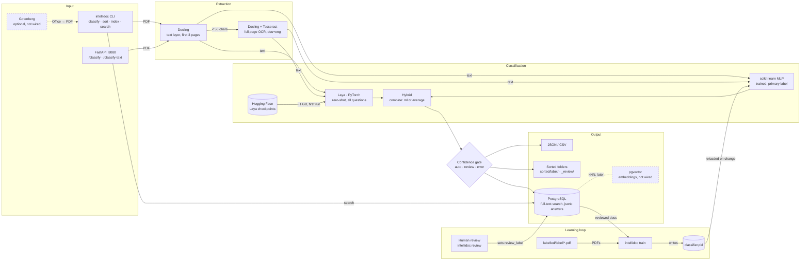

# Extraction
* https://github.com/docling-project/docling
* https://github.com/tesseract-ocr/tesseract

# Classification
* https://github.com/NandhaKishorM/laya
* https://github.com/scikit-learn/scikit-learn
* https://github.com/pytorch/pytorch

# API
* https://github.com/fastapi/fastapi

# Conversion (optional, for later use)
* https://github.com/gotenberg/gotenberg

# Storage & Search
* https://github.com/postgres/postgres
* https://github.com/pgvector/pgvector

# Architecture

`classification.backend` (or `--backend`) selects Laya alone, the trained MLP alone, or Hybrid (the MLP sets the label; Laya answers the yes/no and score questions).
